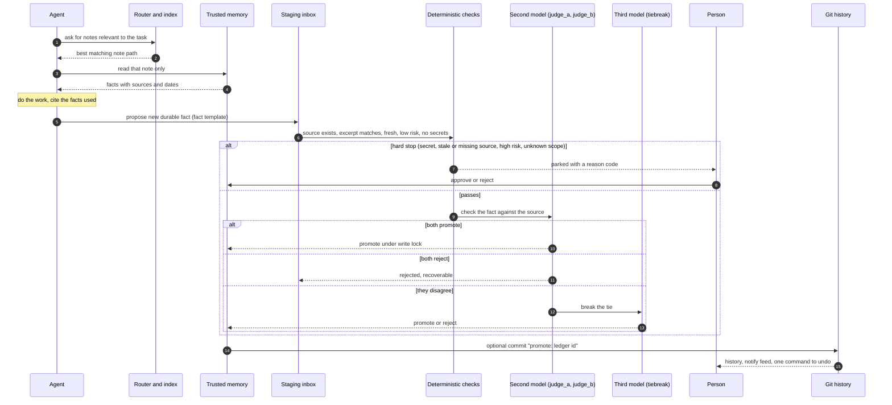

# How agents use the memory

This is the full lifecycle an agent follows on every task: read before, cite during,
propose after. The agent never writes to the trusted memory. It only proposes.

## Before a task: read

1. **Read the index.** The index is the short list of note titles and one line summaries.
   It is cheap to read and tells the agent what exists.
2. **Route to the right notes.** Do not read the whole memory. Ask the router for the best
   match for the task:

   ```bash
   python3 router/route.py --indexdir "$ROUTER_INDEX" "who approves blog posts for the bakery"
   ```

   One clear winner prints a title and a path. If nothing matches, the router says so and
   the agent carries on without memory rather than guessing. If two notes tie, the router
   reports ambiguity, and the agent refines the query or lists candidates with `--json
   --limit 5`.
3. **Read only those notes.** Open the one or two notes the router returned. To keep reads
   inside the allowed folders, use `--show --allow-root "$VAULT_ROOT"`.

## During the task: cite

When the agent relies on a remembered fact, it says so. A short citation is enough: the
note title and the fact. This makes wrong facts visible, because a person can see which
note led to a decision, and it tells the agent which facts proved useful.

If a remembered fact conflicts with what the agent sees in the task (the live file, the
client's latest email, the code), the live evidence wins and the agent proposes a
correction afterwards. It does not edit the note.

## After the task: propose

The agent proposes new durable facts to staging, one file per fact, in the fact template
(`vault/templates/candidate-fact.yaml`).

**Durable** means it will still be true and useful in a month, and a stranger could act on
it without extra context:

- a preference ("client emails are short and plain")
- a decision with the choice made ("the site is built on Astro, not WordPress")
- a workflow or rule ("blog posts are approved by the client before publishing")
- a boundary ("never email the client's staff directly")
- a tool fact ("the staging site deploys from the main branch")

**Not durable**, so do not propose it:

- the progress of this task, today's status, or a to do list
- guesses, opinions, predictions, or anything hedged ("probably", "I think")
- anything you cannot point to a source for
- reference material that already lives somewhere else (link it, do not copy it)

Every proposal needs a **source** (a path to something that can be re-read) and an
**observed date**. The excerpt must be copied word for word from the source.

**Never propose** secrets (passwords, tokens, keys, connection strings), raw transcripts,
personal data about individuals, contact details, or money figures. The checks refuse these
anyway, and a refusal is logged. Do not try to rephrase around the check.

## Then the check

The proposal goes through the funnel. See `docs/promotion-protocol.md` for the detail.



## Rules of thumb for the agent

- One fact per proposal. Short and explicit.
- If unsure whether something is durable, do not propose it. A missing fact costs a
  question later. A wrong fact costs trust.
- Never write to the trusted folder, never edit a note, never run the promotion step
  yourself unless a person has told you that you are the promoting tool.
- Snippets you can paste into your agent configuration are in `agent-instructions/`.
